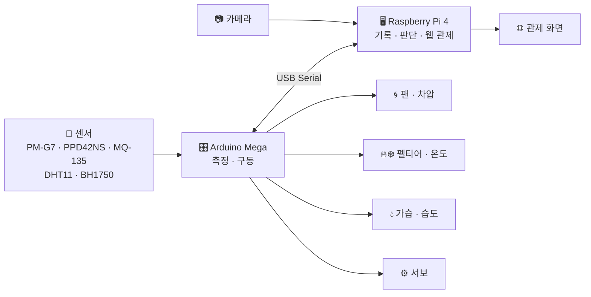

# 🧪 Cleanroom Env Control

**클린룸 환경 자동 유지 및 통합 관제 시스템**
반도체 클린룸 축소 모델에서 🌬 차압 · 🌡 온도 · 💧 습도 · 🌫 미세먼지를 측정하고 자동으로 유지하는 시스템

| 📍 단계 | 🛠 하드웨어 | 💻 소프트웨어 |
|---|---|---|
| 1차 준비 | Raspberry Pi 4 · Arduino Mega 2560 | C++ (Arduino) · Python |

---

## 🧭 시스템 구성

## 📂 저장소 구조

| 폴더 | 내용 |
|---|---|
| [`firmware/`](firmware) | 🎛 아두이노 코드 |
| [`pi/`](pi) | 🖥 라즈베리파이 코드 (수집 · 관제) |
| [`hardware/`](hardware) | 📐 핀맵 · 배선도 · 부품 |
| [`data/`](data) | 📊 측정 데이터 샘플 |
| [`docs/`](docs) | 📚 개발 환경 · 사용 방법 |

## 🗺 로드맵

- [ ] ⚡ 전기 작업 · 부품 선정
- [ ] 📊 차압 · 온습도 데이터 수집
- [ ] 🧠 제어 로직 수립
- [ ] 📦 환경(상자) 제작 · 통합

## 🔗 링크

- 📒 Notion — 회의록 · 결정 기록 · 부품 대장
- 📁 [Google Drive](https://drive.google.com/drive/folders/1VJQIIZx4PPXjgUougvZJCLtndTSsHTmV) — 사진 · 영상 · 원본 데이터

## 🚀 처음이라면

👉 [docs/getting-started.md](docs/getting-started.md)

## 👥 Team

1210 · 박지원 · 임건우 · 허남현
