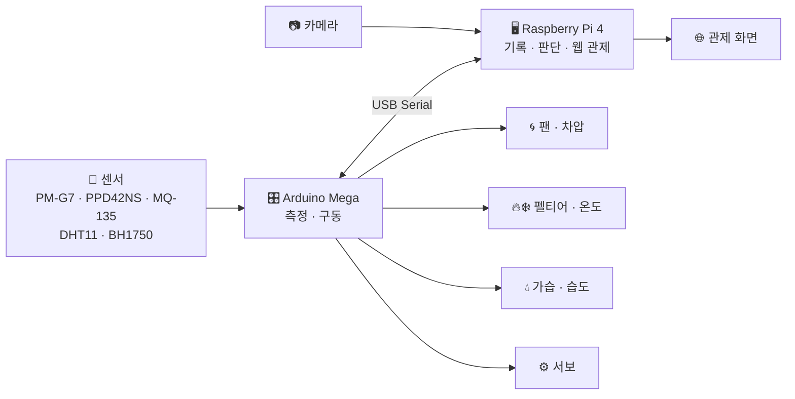

# 🧪 Cleanroom Env Control

**클린룸 환경 자동 유지 및 통합 관제 시스템**
반도체 클린룸 축소 모델에서 🌬 차압 · 🌡 온도 · 💧 습도 · 🌫 미세먼지를 측정하고 자동으로 유지하는 시스템

| 📍 단계 | 🛠 하드웨어 | 💻 소프트웨어 |
|---|---|---|
| 0차 전기 작업 · 1차 센서 측정 중 | Raspberry Pi 4 · Arduino Mega 2560 | C++ (Arduino) · Python |

---

## 🧭 시스템 구성

## 📂 저장소 구조

| 폴더 | 내용 |
|---|---|
| [`firmware/`](firmware) | 🎛 아두이노 코드 |
| [`pi/`](pi) | 🖥 라즈베리파이 코드 (수집 · 관제) |
| [`hardware/`](hardware) | 📐 핀맵 · 연결표 (도면 그림은 드라이브) |
| [`data/`](data) | 📊 측정 데이터 샘플 |
| [`docs/`](docs) | 📚 개발 환경 · 사용 방법 |
| [`scripts/`](scripts) | 🛠 저장소 설정 스크립트 |

## 🗺 로드맵

| 단계 | 내용 | 상태 |
|---|---|---|
| ⚡ 0차 전기 | 전원 구조 · 전기 부품 · 배선 | 진행 중 |
| 📊 1차 측정 | 센서별 단독 측정 · 데이터 수집 | 진행 중 |
| 🎛 2차 | 차압 · 온습도 제어 · 통합 | 예정 |
| 📦 3차 | 본체 제작 · 전체 통합 · 시연 | 예정 |

## 🧩 파트

| 파트 | 범위 |
|---|---|
| 🌬 공기·청정 | 차압, 팬, 필터, 먼지 센서 |
| 🌡 온습도 | 펠티어, 가습, 온습도 센서 |
| 🧩 통합·관제 | 라즈베리파이, 데이터 수집, 관제 화면, 출입 |
| 🔗 공통 | 전원, 배선, 보드 |

## 🔗 링크

- 📒 Notion (팀 전용) — 회의록 · 결정 로그 · 작업 보드 · 부품 대장
- 📁 [Google Drive](https://drive.google.com/drive/folders/1VJQIIZx4PPXjgUougvZJCLtndTSsHTmV) — 사진 · 영상 · 원본 데이터

## 🚀 처음이라면

👉 [docs/getting-started.md](docs/getting-started.md)

## 👥 Team

1210 · 박지원 · 임건우 · 허남현
