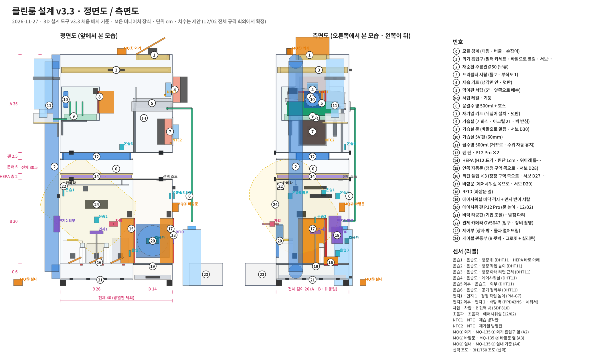
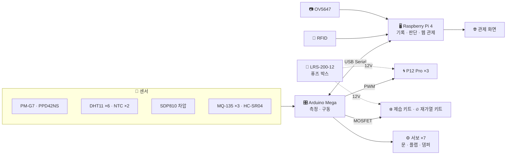

# 🧪 Cleanroom Env Control

**클린룸 환경 자동 유지 및 통합 관제 시스템**
반도체 클린룸 축소 모델에서 🌬 차압 · 🌡 온도 · 💧 습도 · 🌫 미세먼지를 측정하고 자동으로 유지하는 시스템

| 📍 단계 | 📐 설계 | 🛠 하드웨어 | 💻 소프트웨어 |
|---|---|---|---|
| 1차 센서 측정 중 · 전기 작업 12월 말 | v3.3 (2026-11-27) | Raspberry Pi 4 · Arduino Mega 2560 | C++ (Arduino) · Python |

---

## 🏗 구조 (설계 v3.3)

| 구역 | 크기 (cm) | 역할 |
|---|---|---|
| 🏭 A 상류 챔버 | 40 × 26 × 35 | 외기 · 재순환 공기를 거르고 제습 · 재가열 · 가습 |
| 🌀 팬 · 분배 · HEPA | 26 × 26 × 9.5 | P12 Pro ×2 → 분배 공간 → HEPA |
| ✨ B 청정 구역 | 26 × 26 × 30 | 양압(+10Pa 목표) 유지 · 미니어처 반도체 라인 |
| 💨 D 에어샤워실 | 14 × 26 × 30 | RFID 출입 · 분사 · 격자 바닥 |
| 🔄 C 하부 리턴 | 26 × 26 × 6 | 리턴 플랩 ×3 · 재순환 · 타공판 배기 |

치수는 12/02 전체 규격 회의에서 확정 · 정면은 아크릴(전시), 나머지는 포맥스 · 3단 모듈로 분리

## 🧭 시스템 구성

- 🔌 배선 · 핀 → [`hardware/`](hardware)
- ⚡ 배선도 미리보기 → [docs/images/wiring_v3.2.png](docs/images/wiring_v3.2.png)

## 👥 역할

| 파트 | 담당 | 범위 |
|---|---|---|
| 🌬 공기·청정 | 임건우 | 차압, 팬, 필터, 먼지 센서 |
| 🌡 온습도 | 허남현 | 제습 · 재가열 키트, 기화식 가습, 온습도 센서 |
| 🧩 통합·관제 · 전체 관리 | 박지원 | 라즈베리파이, 데이터, 관제 화면, 출입, 전기 · 구조 |

## 📂 저장소 구조

| 폴더 | 내용 |
|---|---|
| [`firmware/`](firmware) | 🎛 아두이노 코드 · 센서별 시험 스케치 |
| [`pi/`](pi) | 🖥 라즈베리파이 코드 (수집 · 관제 · 출입) |
| [`hardware/`](hardware) | 📐 핀맵 · 전원 구성 |
| [`data/`](data) | 📊 측정 데이터 샘플 |
| [`docs/`](docs) | 📚 개발 환경 · 사용 방법 · 그림 |
| [`scripts/`](scripts) | 🛠 저장소 설정 스크립트 |

## 🗺 로드맵

| 단계 | 내용 | 상태 |
|---|---|---|
| 📊 1차 측정 | 센서 값 받기 · 보정 · 차압 / 온습도 시험 | 진행 중 |
| ⚡ 0차 전기 | 전원 · 퓨즈 · MOSFET · 배선 | 부품 도착 후 12월 말 |
| 🎛 2차 | 차압 · 온습도 제어 · 통합 | 예정 |
| 📦 3차 | 본체 제작 · 전체 통합 · 시연 | 예정 |

## 🔗 링크

- 📒 Notion (팀 전용) — 회의록 · 결정 로그 · 작업 보드 · 부품 대장 · 설계 문서
- 📁 [Google Drive](https://drive.google.com/drive/folders/1VJQIIZx4PPXjgUougvZJCLtndTSsHTmV) — 도면 원본 · 사진 · 영상 · 원본 데이터

## 🚀 처음이라면

👉 [docs/getting-started.md](docs/getting-started.md)

## 👥 Team

1210 · 박지원 · 임건우 · 허남현
