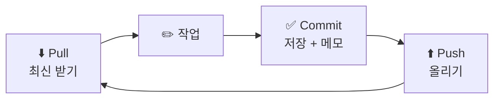

# 🚀 Getting Started

GitHub이 처음이어도 이 순서대로 하면 됩니다.

## 1️⃣ 준비

| 도구 | 용도 |
|---|---|
| [GitHub Desktop](https://desktop.github.com/) | 🖱 버튼으로 Git 사용 (처음이면 추천) |
| [VS Code](https://code.visualstudio.com/) | ✏️ 코드 편집 |
| [Arduino IDE](https://www.arduino.cc/en/software) | 🎛 아두이노 업로드 |

## 2️⃣ 저장소 내 컴퓨터로 가져오기 (Clone)

GitHub Desktop → `File` → `Clone repository` → `2026_27_CLEANROOM-ENV-CONTROL`

## 3️⃣ 기본 흐름



| 단계 | GitHub Desktop | 터미널 |
|---|---|---|
| ⬇️ 최신 받기 | `Fetch origin` → `Pull` | `git pull` |
| ✅ 저장 | 왼쪽 아래 Summary 입력 → `Commit` | `git add .` → `git commit -m "메모"` |
| ⬆️ 올리기 | `Push origin` | `git push` |

> 💡 작업 **시작 전에 항상 Pull** — 충돌을 줄이는 가장 쉬운 방법

## ⚠️ 올리면 안 되는 것

- 🔑 비밀번호 · 와이파이 정보 (`.env`)
- 📦 큰 영상 · 원본 데이터 → 📁 드라이브로

## 🏷 라벨 · 마일스톤 (처음 한 번)

[GitHub CLI](https://cli.github.com/) 설치 → `gh auth login` → 저장소 폴더에서

```bash
bash scripts/setup-github.sh
```
